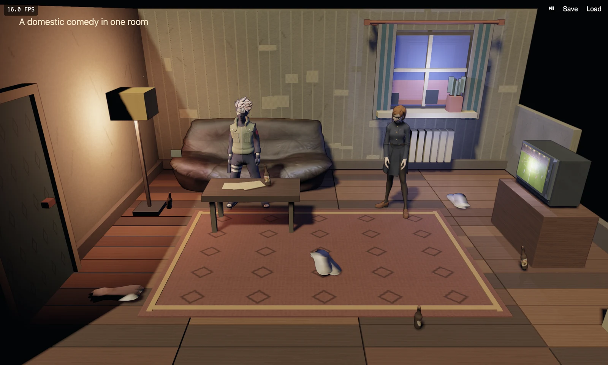
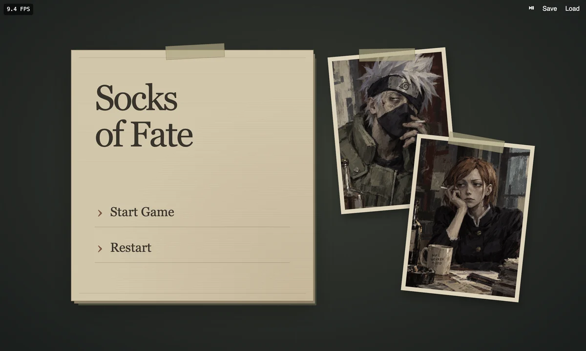
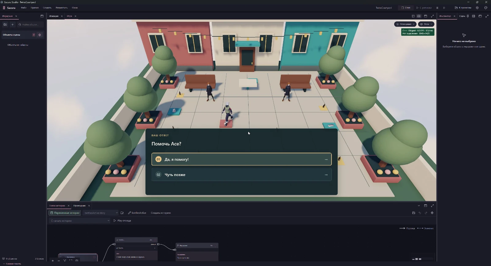
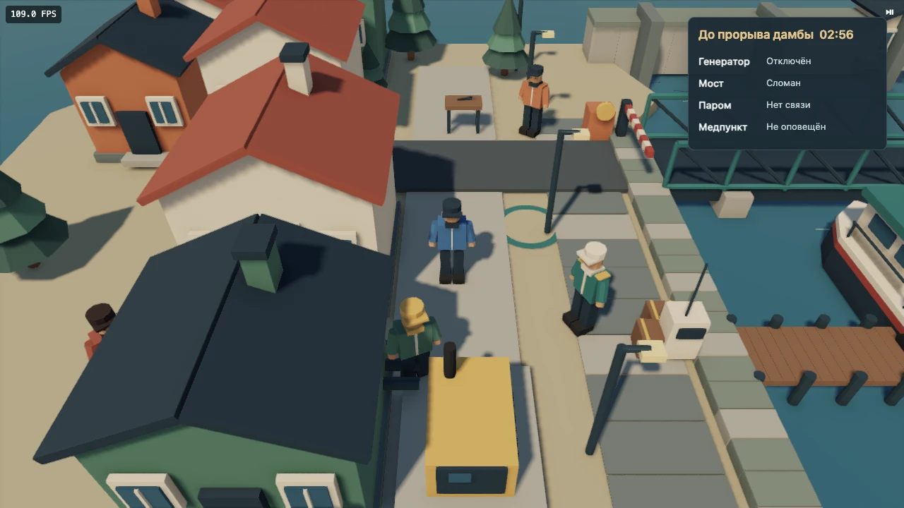
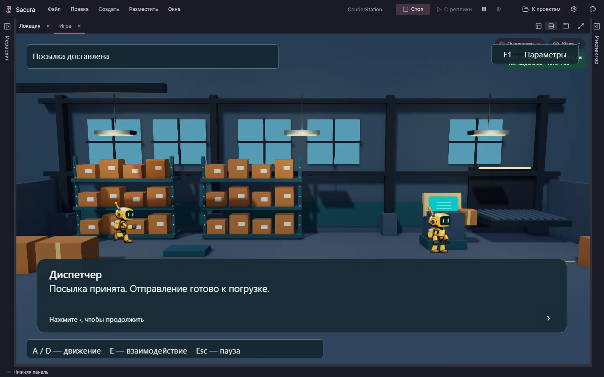
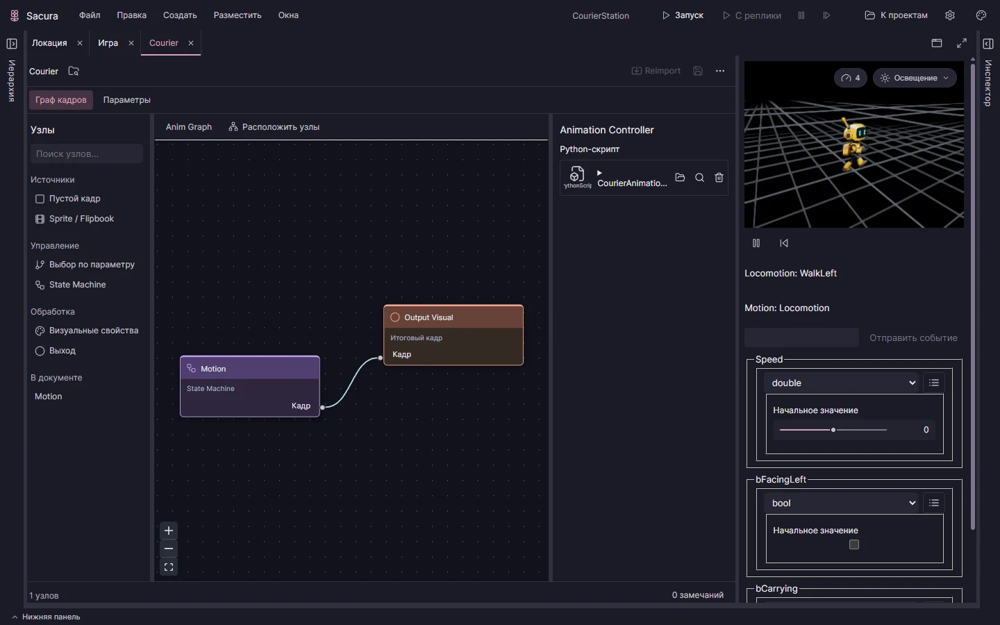

# Sacura Novel Engine 3D

A player promises to clean up the apartment. What happens after they pick that line? In Sacura, you can give them control of the character, let them move through the room, and bring the conversation back when they pick up the last sock. Build the dialogue, the room and the rules in the same desktop editor.

**[Play Socks of Fate · free Windows demo](https://syperolao.itch.io/sacura-interactive-demo)** · [Editor releases](https://github.com/1000bets/Sacura-Releases/releases) · [Sacura on itch.io](https://syperolao.itch.io/sacura-novel-engine) · [Русский](README.ru.md)

## A five-minute visual novel you can take apart

*Socks of Fate* starts with Garry, Laura, and an argument about the apartment. One answer gets Garry off the couch to collect three bottles and three socks. Another sends the evening toward a different ending. You can play the [standalone demo](https://syperolao.itch.io/sacura-interactive-demo) before trying the editor.

**Try your first edit.** Create a **Visual Novel** project, open **Opening** in Story Flow, and rewrite Garry’s answer. Press **Play** and choose your line. Follow its wire in the graph to see where the camera changes, an animation starts, or control passes to the player. The template includes English dialogue, voice acting, and both endings.

| Give the story its own look | Write a choice in context |
| --- | --- |
|  |  |
| The apartment template ships with its own menu, portraits, and loading screen. | In **Twins Courtyard**, accepting Asya’s request starts a timed search. Come back to her and the dialogue changes with your progress. |

## Build a quest with more than one way out

In **Last Voyage**, the dam will break in three minutes. Restore power and repair the bridge, or clear a path to the ferry. Once either route is ready, you can leave. Will you take the time to escort the clinic patient first?

**Try the quest editor.** Open **HarbourOperations** in the template and trace the bridge and ferry quests to the evacuation quest. The generator and the bridge mechanism can be fixed in either order. A save made between repairs remembers which job you finished. [See the harbour in the editor](screenshots/last-voyage-editor.webp).

## Make a 2D character feel at home in a 3D scene

In **Courier Station**, walk to the shelf, pick up a parcel, and take it to the terminal. Watch the courier’s hands as the box changes owners. The handoff is timed to a frame in the sprite animation. The second robot shares the same animation graph and moves on its own clock.

| Deliver the parcel | Inspect the motion |
| --- | --- |
|  |  |

Open **Courier** in the animation editor and preview pickup, delivery and the walk cycle with a parcel. For a character who makes its own decisions, combine navigation with a Behavior Tree and inspect its active branch during Play. Python components let you add your own interactions. [See the Behavior Tree debugger](screenshots/behavior-tree.webp).

## Get started

1. Open [Releases](https://github.com/1000bets/Sacura-Releases/releases) and pick your platform under **Assets**.

   | Platform | Archive |
   | --- | --- |
   | Windows x64 | `Sacura-Editor-Windows-x64.zip` |
   | Linux x64 | `Sacura-Editor-Linux-x64.tar.gz` |
   | macOS 14+ on Apple Silicon | `Sacura-Editor-macOS-arm64.zip` |

2. Extract the archive and launch **Sacura Editor**. On macOS, open the extracted app. On Linux, run `./sacura-editor` from the extracted folder.
3. Create a project from **Visual Novel** for a dialogue-first example or **Courier Station** to try 2.5D gameplay. Press **Play** to explore the example before editing it.

Found a bug? Include the build number, your OS, and the steps to reproduce it. [Open an issue](https://github.com/1000bets/Sacura-Releases/issues/new).
