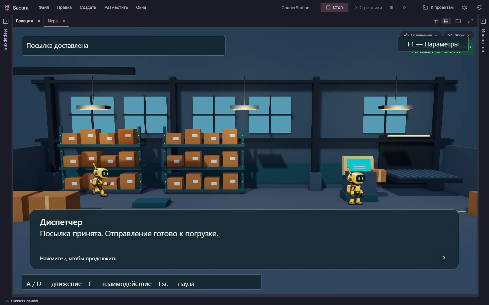
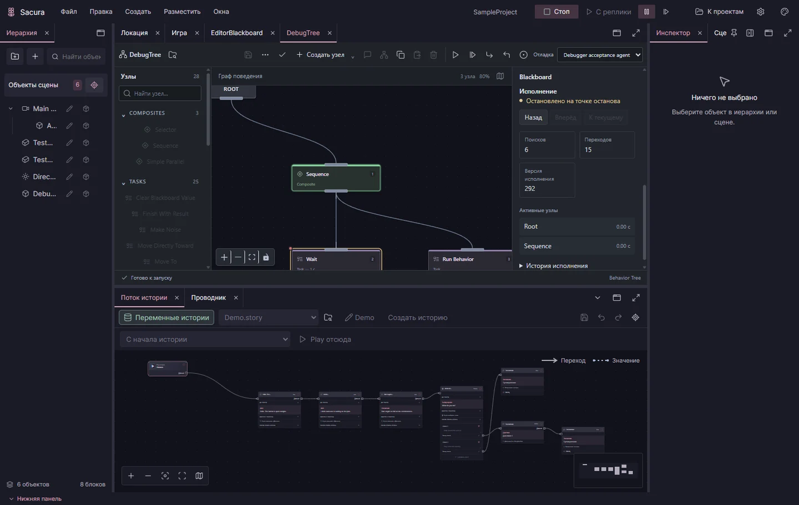

# Sacura Novel Engine 3D

**Создавайте визуальные новеллы и сюжетные игры в 3D.** Соберите сцену, напишите диалог с развилками и запустите игру прямо в редакторе, чтобы увидеть, к чему приведёт выбор игрока.

**[Скачать Sacura Editor](https://github.com/1000bets/Sacura-Releases/releases)** · [English](README.md)

*«Двор двух сестёр» в режиме игры. Под сценой открыт граф истории.*

## Что можно сделать

- **Истории с развилками.** Связывайте реплики, варианты ответов, условия и переменные в графе истории. Реплика может переключить камеру, запустить анимацию или выдать квест.
- **Локации, которые хочется исследовать.** Собирайте 3D-сцены со светом, камерами, материалами и переиспользуемыми префабами. Сочетайте скелетных персонажей и анимированные 2D-спрайты для игр в 2.5D.
- **Квесты, которые реагируют на события в игре.** Управляйте целями и состоянием мира. Продвигайте сюжет после разговора, подбора предмета или взаимодействия с объектом.
- **Персонажи со своим поведением.** Настраивайте движения и реакции в графах анимации. Используйте навигацию, деревья поведения и Blackboard для NPC и наблюдайте за выполнением в отладчике. Свою игровую логику можно добавить на Python.
- **Играбельный прототип с первого запуска.** Возьмите готовый шаблон, нажмите **Запуск** и измените первую реплику или взаимодействие.

## Как выглядит редактор

| «Курьерская станция» в режиме игры | Граф анимации спрайтов | Отладчик дерева поведения |
| --- | --- | --- |
|  |  |  |

## Первый запуск

1. Откройте [Releases](https://github.com/1000bets/Sacura-Releases/releases) и выберите архив для своей системы в разделе **Assets**.

   | Система | Архив |
   | --- | --- |
   | Windows x64 | `Sacura-Editor-Windows-x64.zip` |
   | Linux x64 | `Sacura-Editor-Linux-x64.tar.gz` |
   | macOS 14+ на Apple Silicon | `Sacura-Editor-macOS-arm64.zip` |

2. Распакуйте архив и запустите **Sacura Editor**. На macOS откройте распакованное приложение. На Linux запустите `./sacura-editor` из распакованной папки.
3. Создайте проект из шаблона **«Визуальная новелла»**, чтобы попробовать диалоги, или **«Курьерская станция»**, чтобы посмотреть игровой процесс в 2.5D. Нажмите **Запуск** и пройдите пример, прежде чем редактировать его.

Нашли ошибку? Укажите номер сборки, ОС и шаги для воспроизведения. [Сообщить об ошибке](https://github.com/1000bets/Sacura-Releases/issues/new).
