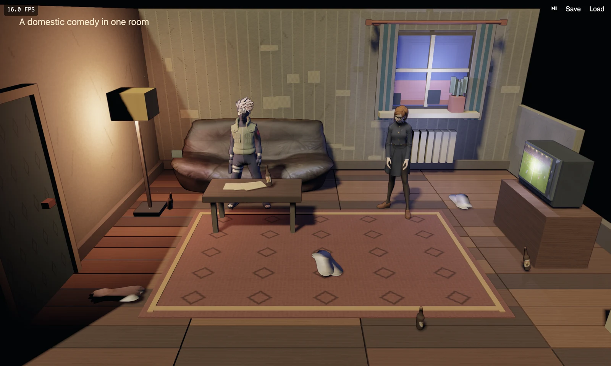
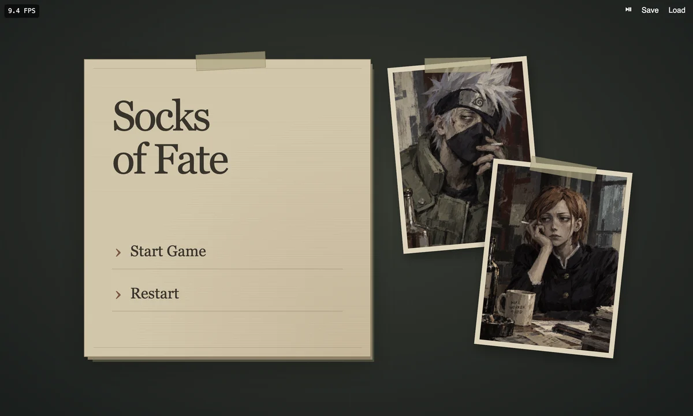
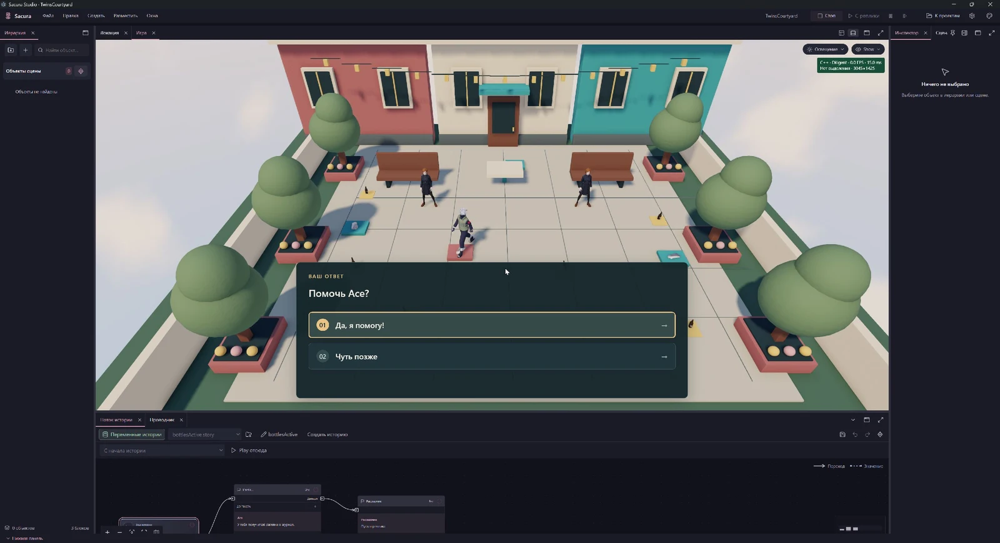
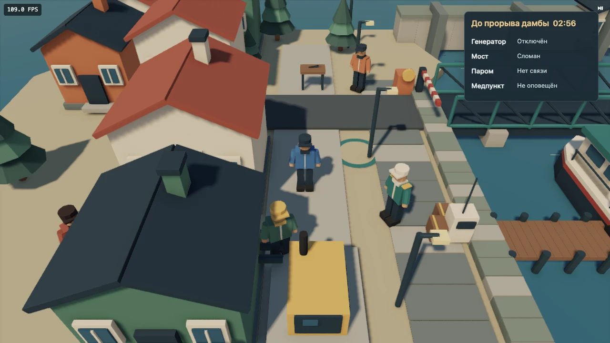
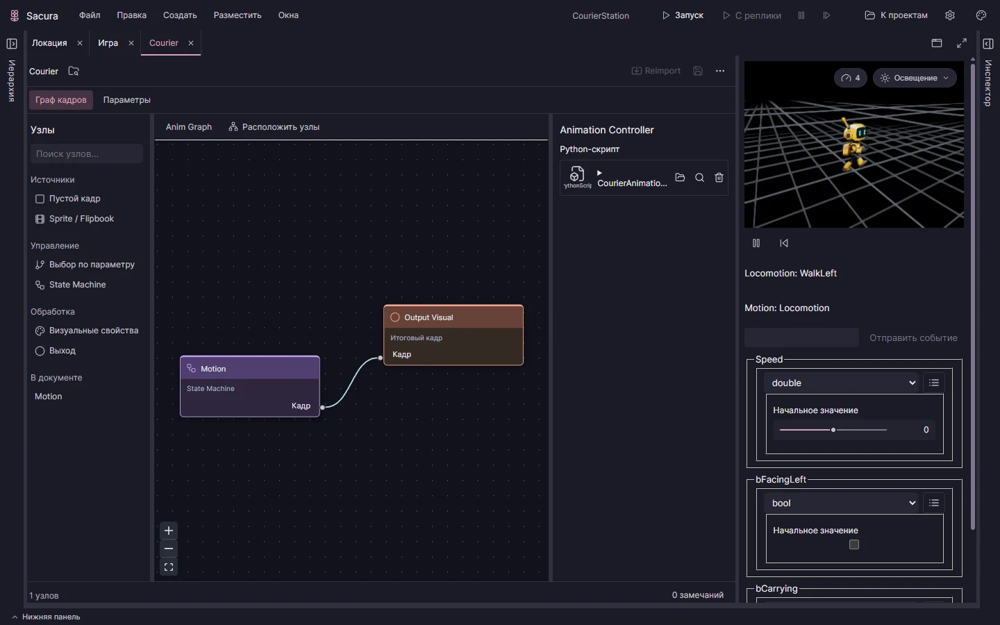

# Sacura Novel Engine 3D

Герой обещает убрать разбросанные вещи. Что будет дальше? В Sacura можно передать ему управление героем, дать пройтись по квартире и вернуть разговор в тот момент, когда он поднимет последний носок. Диалоги, сцену и правила игры вы собираете в одном редакторе.

**[Сыграть в Socks of Fate · бесплатная демоверсия для Windows](https://syperolao.itch.io/sacura-interactive-demo)** · [Сборки редактора](https://github.com/1000bets/Sacura-Releases/releases) · [Sacura на itch.io](https://syperolao.itch.io/sacura-novel-engine) · [English](README.md)

## Пятиминутная новелла, которую можно разобрать в редакторе

В *Socks of Fate* Гарри и Лора ссорятся из-за беспорядка. Один ответ заставит Гарри встать с дивана и собрать три бутылки и три носка. Другой приведёт вечер к иной развязке. В [демоверсию](https://syperolao.itch.io/sacura-interactive-demo) можно сыграть ещё до знакомства с редактором.

**Попробуйте изменить одну реплику.** Создайте проект из шаблона **«Визуальная новелла»**, откройте **Opening** в графе истории и перепишите ответ Гарри. Нажмите **Запуск** и выберите свою реплику. По связям в графе можно увидеть, где меняется камера, начинается анимация или игрок получает управление. В шаблоне уже есть английские диалоги с озвучкой и обе концовки.

| Оформление истории | Выбор в контексте сцены |
| --- | --- |
|  |  |
| У новеллы про квартиру свои меню, портреты и экран загрузки. | Во «Дворе двух сестёр» согласие помочь Асе запускает поиск на время. Если вернуться к ней во время задания и после него, ответы будут разными. |

## Квест, из которого есть два выхода

В **«Последнем рейсе»** через три минуты прорвёт дамбу. Можно включить генератор и починить мост или освободить проход к парому. Как только готов хотя бы один маршрут, пора отправляться. Успеете ли вы перед этим вывести пациентку из медпункта?

**Попробуйте редактор квестов.** Откройте **HarbourOperations** в шаблоне и проследите, как задания моста и парома связаны с эвакуацией. Генератор и привод моста можно чинить в любом порядке. Если сохраниться между ремонтами, игра запомнит, какой из них вы закончили. [Посмотреть гавань в редакторе](screenshots/last-voyage-editor.webp).

## Рисованный персонаж в трёхмерной сцене

На **«Курьерской станции»** подойдите к стеллажу, заберите посылку и доставьте её к терминалу. Присмотритесь к рукам курьера. Коробка переходит к нему в заданном кадре анимации. Второй робот использует тот же граф и движется в собственном ритме.

| Доставка на склад | Движение курьера в редакторе |
| --- | --- |
|  |  |

Откройте **Courier** в редакторе анимации и посмотрите, как робот подбирает посылку, идёт с ней и передаёт её. Для персонажа, который сам решает, куда идти, можно соединить навигацию с деревом поведения и следить за активной веткой во время игры. Свои взаимодействия можно писать на Python. [Посмотреть отладчик дерева поведения](screenshots/behavior-tree.webp).

## Первый запуск

1. Откройте [Releases](https://github.com/1000bets/Sacura-Releases/releases) и выберите архив для своей системы в разделе **Assets**.

   | Система | Архив |
   | --- | --- |
   | Windows x64 | `Sacura-Editor-Windows-x64.zip` |
   | Linux x64 | `Sacura-Editor-Linux-x64.tar.gz` |
   | macOS 14+ на Apple Silicon | `Sacura-Editor-macOS-arm64.zip` |

2. Распакуйте архив и запустите **Sacura Editor**. На macOS откройте распакованное приложение. На Linux запустите `./sacura-editor` из распакованной папки.
3. Создайте проект из шаблона **«Визуальная новелла»**, чтобы попробовать диалоги, или **«Курьерская станция»**, чтобы посмотреть игровой процесс в 2.5D. Нажмите **Запуск** и пройдите пример, прежде чем редактировать его.

Нашли ошибку? Укажите номер сборки, ОС и шаги для воспроизведения. [Сообщить об ошибке](https://github.com/1000bets/Sacura-Releases/issues/new).
